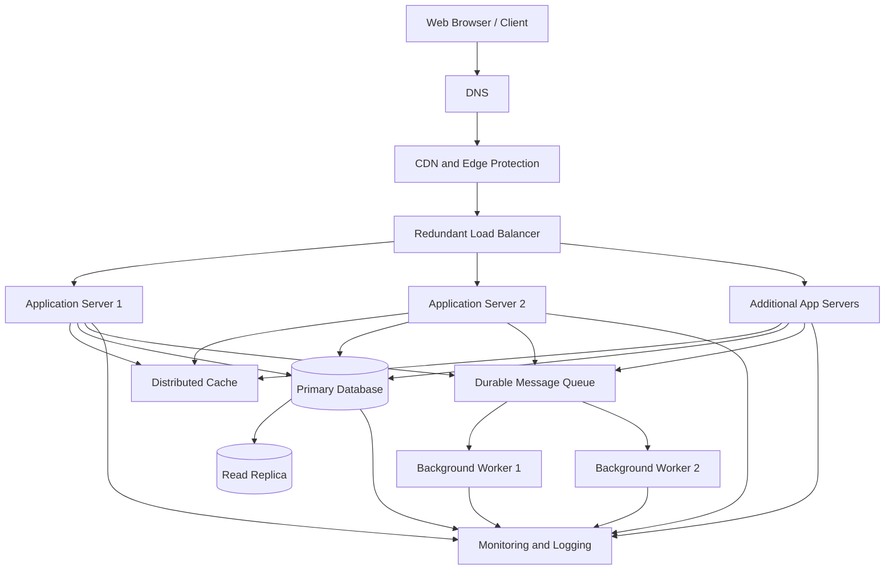

# QuickNotes System Architecture

## 1. Overview

QuickNotes is a web-based note-taking application that allows users to create, view, update, delete, search, and organize notes using tags.

The system is designed to support up to one million registered users while maintaining good performance, availability, security, and scalability.

The architecture uses a load balancer, multiple application servers, caching, a primary database with a read replica, and a message queue with background workers.

This design separates responsibilities and allows individual components to scale as demand increases.

---

## 2. Functional Requirements

The system must allow users to:

1. Register and authenticate securely.
2. Create notes with a title and optional body.
3. View a list of their notes.
4. Retrieve an individual note.
5. Update and delete notes.
6. Search notes by title or content.
7. Organize notes using tags.
8. Access their notes from a web browser.
9. Receive appropriate success and error messages.
10. Access only notes they are authorized to view or modify.

## 3. Non-Functional Requirements

### Scalability
The system should support increasing numbers of users and requests by scaling application servers and database resources.

### Availability
The application should remain accessible when an individual application server fails.

### Performance
Frequently requested data should be returned quickly through caching and optimized database queries.

### Security
The system should use HTTPS, secure authentication, authorization checks, input validation, rate limiting, and secure password hashing.

### Reliability
Database backups, replication, health checks, and recovery procedures should help prevent data loss and reduce downtime.

### Maintainability
The application should use modular components, centralized monitoring, structured logs, and automated tests.

### Data Consistency
Database transactions and constraints should maintain reliable relationships between users, notes, and tags.

---

## 4. Assumptions for One Million Users

The following estimates are illustrative planning assumptions, not measured production traffic.

- Registered users: 1,000,000
- Daily active users: 10% of registered users
- Daily active users: 100,000
- Average reads per active user per day: 20
- Average writes per active user per day: 2
- Average stored size per new note, including metadata: 10 KB
- Days per year: 365
- Peak traffic assumption: five times average traffic

Actual usage, note sizes, caching efficiency, and retention policies would need to be measured before production deployment.

### 4.1 Daily Read Requests

100,000 active users × 20 reads per day:

2,000,000 reads per day.

Average read requests per second:

2,000,000 ÷ 86,400 ≈ 23 reads per second.

Estimated peak read traffic:

23 × 5 ≈ 116 reads per second.

### 4.2 Daily Write Requests

100,000 active users × 2 writes per day:

200,000 writes per day.

Average write requests per second:

200,000 ÷ 86,400 ≈ 2.3 writes per second.

Estimated peak write traffic:

2.3 × 5 ≈ 12 writes per second.

Writes include creating or updating notes. Deletions and other database operations may add additional load.

### 4.3 Estimated Annual Storage

Assume each new note consumes an average of 10 KB, including its stored content and metadata.

Daily storage:

200,000 notes × 10 KB = approximately 2 GB per day.

Annual storage:

2 GB × 365 = approximately 730 GB per year.

This is an approximate estimate of new note data before accounting for database indexes, replication, backups, updates, and storage overhead. Actual storage requirements will depend on average note size and retention.

### 4.4 Summary of Estimates

| Metric | Estimate |
|---|---:|
| Registered users | 1,000,000 |
| Daily active users | 100,000 |
| Average reads per second | 23 |
| Estimated peak reads per second | 116 |
| Average writes per second | 2.3 |
| Estimated peak writes per second | 12 |
| New notes per day | 200,000 |
| Approximate annual note storage | 730 GB |

These estimates provide an initial capacity-planning baseline. Production capacity should be validated using load testing and real application metrics.

---

## 5. High-Level Architecture Diagram



### Architecture Components

**1. Web Browser / Client**

Provides the user interface for creating, reading, updating, and deleting notes.

**2. DNS**

Translates the application domain name into the appropriate network destination. A reliable DNS provider helps users reach the application.

**3. CDN and Edge Protection**

Delivers static resources such as CSS, JavaScript, and images from nearby edge locations. Edge protection can also help mitigate certain malicious traffic patterns.

Private note content must not be publicly cached. Personalized responses should use appropriate cache-control policies.

**4. Redundant Load Balancer**

Distributes incoming requests across healthy application servers and performs health checks. A highly available or managed configuration helps avoid a single load-balancer failure taking down the application.

**5. Application Servers**

Run the QuickNotes backend API, authentication, validation, authorization, and business logic. At least two instances provide redundancy, and additional instances can be added as demand grows.

**6. Distributed Cache**

Stores frequently accessed data, such as selected note-list results or session-related information where appropriate. This reduces repeated database reads.

Cache entries must be invalidated or updated after relevant changes. Cache failure should result in a safe fallback to the database rather than application-wide failure.

**7. Primary Database**

Stores authoritative user, note, tag, and relationship data. Create, update, and delete operations are directed to the primary database.

**8. Read Replica**

Receives replicated database changes and serves suitable read-only queries. It reduces read pressure on the primary database.

Replication can lag, so operations requiring immediate read-after-write consistency should read from the primary database.

**9. Durable Message Queue**

Stores background jobs until workers process them. Jobs may include sending notifications, generating activity summaries, or performing analytics.

The application should only acknowledge queued work once the queue has accepted it successfully.

**10. Background Workers**

Process queued jobs independently of the user's immediate request. Multiple worker instances improve throughput and allow jobs to continue when an individual worker fails.

**11. Monitoring and Logging**

Collects metrics, application errors, database health, queue depth, and request latency. Alerts help operators detect problems before they cause prolonged outages.

---

## 6. Request Flow: GET /notes

The GET endpoint retrieves the authenticated user's notes.

1. The user opens the notes page in the browser.
2. DNS resolves the application domain.
3. The browser requests the API through the CDN and edge-protection layer.
4. The load balancer routes the request to a healthy application server.
5. The application server authenticates the user and checks authorization.
6. The server checks the cache for an eligible note-list response.
7. If a valid cache entry exists, the server returns the cached result.
8. On a cache miss, the server queries the read replica when appropriate.
9. If current data is required, the server queries the primary database.
10. The server caches an eligible result and returns the response as JSON.
11. The browser renders the notes for the authenticated user.

Example request:

```http
GET /api/v1/notes?page=1&limit=20 HTTP/1.1
Host: api.quicknotes.com
Authorization: Bearer <access_token>
```

Example response:

```json
{
  "data": [
    {
      "id": 101,
      "title": "Study Azure",
      "body": "Review cloud concepts",
      "tags": ["Study", "Cloud"]
    }
  ],
  "pagination": {
    "page": 1,
    "limit": 20,
    "total": 1
  }
}
```

The example shows the API response structure. The actual implementation must calculate pagination metadata from the database and ensure users can retrieve only their own notes.

---

## 7. Request Flow: POST /notes

The POST endpoint creates a new note.

1. The user fills in the note title and optional body.
2. The browser sends a POST request to the API over HTTPS.
3. The load balancer routes the request to a healthy application server.
4. The server authenticates the user and validates the request body.
5. The server confirms that the user is authorized to create notes.
6. The server inserts the new note into the primary database.
7. The database assigns a unique note ID and commits the transaction.
8. The server invalidates or updates relevant cache entries.
9. If background processing is needed, the server submits a job to the message queue.
10. The API returns a successful response, typically HTTP 201 Created.
11. The browser displays the new note.

Example request:

```http
POST /api/v1/notes HTTP/1.1
Host: api.quicknotes.com
Authorization: Bearer <access_token>
Content-Type: application/json
```

```json
{
  "title": "Study Azure",
  "body": "Review cloud concepts",
  "tags": ["Study", "Cloud"]
}
```

Example response:

```http
HTTP/1.1 201 Created
Content-Type: application/json
```

```json
{
  "data": {
    "id": 102,
    "title": "Study Azure",
    "body": "Review cloud concepts",
    "tags": ["Study", "Cloud"]
  }
}
```

The note must be saved successfully before the API reports that it has been created. Background tasks should not unnecessarily delay the response.

---

## 8. Caching Strategy

QuickNotes can use a distributed cache to reduce database load.

Potential cached data includes:

- Frequently accessed note-list results.
- Tag lists.
- Other non-sensitive data that is safe to reuse.

### Cache-Aside Approach

1. The application checks the cache.
2. If the data is available and valid, it returns the cached result.
3. Otherwise, it queries the database.
4. The application places an eligible result in the cache.
5. After a note changes, the application invalidates or refreshes the affected entries.

### Cache Considerations

- Cache keys must include the user identity and relevant query parameters.
- Private data must never be exposed through shared cache entries.
- Time-to-live settings prevent cached records from remaining indefinitely.
- Cache outages must not expose data or cause requests to fail unnecessarily.
- Frequently updated data may be better served directly from the database.

---

## 9. Database Scaling and Reliability

The primary database handles authoritative writes, while the read replica handles appropriate read-heavy operations.

### Read Scaling

Additional read replicas can be introduced when read traffic increases. The application can distribute suitable read queries across healthy replicas.

### Write Scaling

The primary database can be upgraded vertically by adding CPU, memory, or faster storage. Query optimization, connection pooling, and efficient indexes should be considered before introducing more complex database partitioning.

If write traffic grows substantially, database sharding or partitioning may be evaluated.

### Backups and Recovery

- Schedule automated database backups.
- Test restoring backups regularly.
- Use replication and automated failover where supported.
- Define recovery point and recovery time objectives.
- Monitor replication lag and database capacity.
- Protect backups with appropriate access controls and encryption.

A read replica is not a replacement for backups because accidental deletions or corrupt changes may also replicate.

---

## 10. Security Architecture

Security controls include:

- HTTPS for data in transit.
- Secure password hashing using a suitable password-hashing algorithm.
- Short-lived access tokens or secure sessions.
- Server-side authentication and authorization.
- User ownership checks for every note operation.
- Input validation and parameterized database queries.
- Rate limiting to reduce abuse.
- Secrets stored outside source code.
- Encryption at rest where supported.
- Restricted database and administrative access.
- Audit logs for relevant security events.
- Data retention and deletion policies.

The application must never rely solely on browser-side validation or user-supplied IDs to enforce authorization.

---

## 11. Architecture Tradeoffs

### Tradeoff 1: Cache Performance vs. Data Freshness

**Benefit:** Caching reduces repeated database reads and can improve response times.

**Cost:** Cache invalidation adds complexity, and cached results can become stale.

**Mitigation:** Use appropriate expiration times, invalidate affected entries after updates, and query the primary database when immediate consistency is required.

### Tradeoff 2: Read Replicas vs. Read-After-Write Consistency

**Benefit:** Read replicas distribute read traffic and reduce pressure on the primary database.

**Cost:** Replication lag may mean a newly created or updated note is temporarily absent from a replica's results.

**Mitigation:** Route consistency-sensitive reads to the primary database and monitor replica lag.

### Tradeoff 3: Asynchronous Processing vs. Operational Complexity

**Benefit:** A queue allows slow background jobs to run without delaying the main request.

**Cost:** Workers, retries, duplicate-job handling, and queue monitoring add complexity.

**Mitigation:** Make jobs idempotent where possible, retry temporary failures with limits, monitor dead-letter queues, and avoid placing essential user-facing database writes behind an unconfirmed asynchronous job.

### Tradeoff 4: High Availability vs. Cost

**Benefit:** Multiple application instances, redundant infrastructure, database failover, and backups reduce the impact of failures.

**Cost:** These services increase infrastructure and operational costs.

**Mitigation:** Begin with a practical baseline, monitor demand, and scale components as actual availability and capacity requirements justify the expense.

---

## 12. Preventing Single Points of Failure

A single point of failure is a component whose failure can make the entire service unavailable.

QuickNotes reduces this risk through the following measures:

| Component | Risk | Mitigation |
|---|---|---|
| DNS | Domain resolution fails | Use a reliable DNS provider and resilient configuration |
| Load balancer | All application traffic is interrupted | Use a highly available or managed load-balancing service |
| Application server | One server crashes | Run at least two instances with health checks |
| Cache | Cached data becomes unavailable | Allow safe database fallback and use a resilient cache deployment |
| Primary database | Writes become unavailable | Use managed database failover and tested recovery procedures |
| Read replica | Read capacity is reduced | Route eligible queries to other healthy replicas or the primary |
| Message queue | Background jobs cannot be accepted | Use durable, resilient queue infrastructure and monitor queue health |
| Worker | Background jobs stop processing | Run multiple workers and retry recoverable failures |
| Monitoring | Failures go undetected | Use independent monitoring and alerting services |

Replication, redundancy, and backups improve resilience, but they do not guarantee zero downtime. Recovery procedures and failover behavior must be tested.

---

## 13. Monitoring and Performance Metrics

The following metrics should be monitored to understand system health.

| Metric | Purpose |
|---|---|
| Requests per second | Measures incoming traffic |
| API response time | Measures application responsiveness |
| HTTP 4xx and 5xx rates | Identifies client errors and service failures |
| CPU and memory usage | Helps identify overloaded application servers |
| Database query latency | Detects slow queries and database pressure |
| Database connection usage | Helps prevent connection exhaustion |
| Cache hit ratio | Measures the effectiveness of caching |
| Queue depth | Identifies background-processing backlogs |
| Worker failure rate | Detects recurring background job failures |
| Replica lag | Measures how far read replicas trail the primary |
| Storage growth | Helps forecast capacity requirements |
| Backup and restore results | Verifies recovery readiness |

Alerts should be based on meaningful thresholds and service objectives rather than metrics alone.

---

## 14. Future Improvements

As QuickNotes grows, possible improvements include:

1. Deploying application servers across multiple availability zones.
2. Automating infrastructure provisioning.
3. Using container orchestration when operationally justified.
4. Introducing more read replicas as read traffic grows.
5. Optimizing database queries and adding measured indexes.
6. Implementing rate limiting and abuse detection at the edge.
7. Using a durable queue for notifications and analytics.
8. Running regular load tests and recovery exercises.
9. Establishing service-level objectives for availability and latency.
10. Reviewing storage and database partitioning as measured demand increases.

These improvements should be introduced according to observed bottlenecks and business requirements.

---

## 15. Conclusion

The proposed QuickNotes architecture supports a path toward one million registered users by separating the client, application, caching, database, and background-processing layers.

Multiple application servers and resilient infrastructure reduce reliance on individual components. Caching and read replicas help scale read traffic, while a primary database maintains authoritative writes.

The traffic and storage calculations provide an initial planning baseline. Load testing, monitoring, security reviews, and recovery exercises are necessary to validate the design before production deployment.
